# Rosary — actual original-source contact gallery (research only)

**Original painting selection is unchanged.** These are source photographs, not cropped/released Prayer UI images. A visible image below only means an exact-original file is archived with a checksum; it does **not** mean that framing, credit, file rights or mobile crops were approved. Never create a rotation or an image change on individual Hail Mary beads.

Staged mystery originals: **11 / 15**. Fixed Lotto cover: **archived**. Unstaged or held mysteries: **4 / 15**. Closing Salve Regina artwork is an additional held slot. App publication-certified images: **0**.

## Fixed cover and opening

<table><tbody><tr><td valign="top" width="20%"><strong>Cover</strong>
<a href="../../assets/staged/prayer-artwork-originals-20261101/lotto-complete-01.jpg">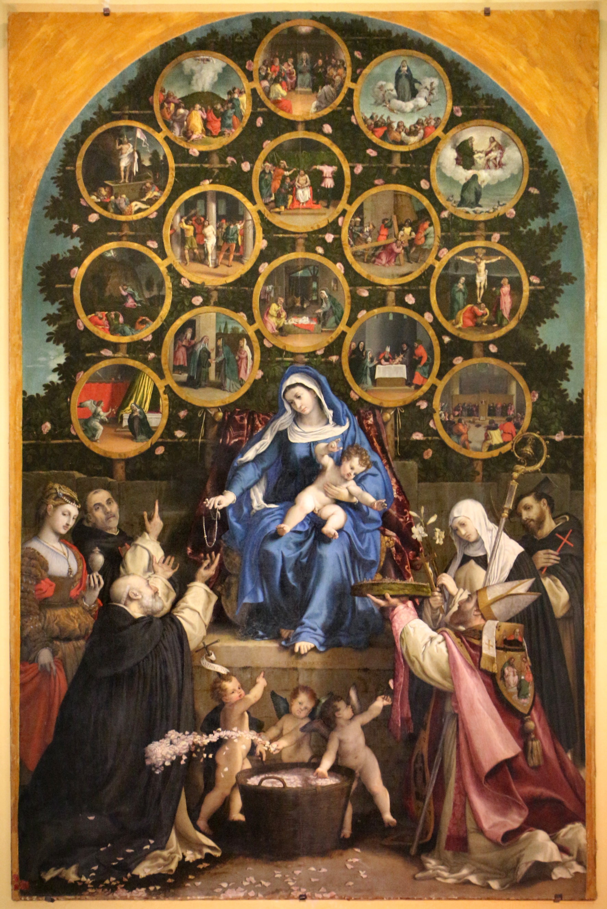</a>
<strong>Madonna del Rosario</strong>
<small>Lorenzo Lotto</small>

<small>Photo licence reported: CC BY 3.0 · Visual QA pending</small>

<small><a href="https://commons.wikimedia.org/wiki/File:Lorenzo_lotto,_madonna_del_rosario,_1539,_01.jpg">Source photograph</a></small>
</td></tr></tbody></table>

The Lotto full-composition file is the cover source. A second archived source photograph is a detail reference, **not** automatic cover rotation.

## Joyful mysteries

<table><tbody><tr><td valign="top" width="20%"><strong>The Annunciation</strong>
<a href="../../assets/staged/prayer-artwork-originals-20261101/rosary-annunciation-bouts-cma.jpg">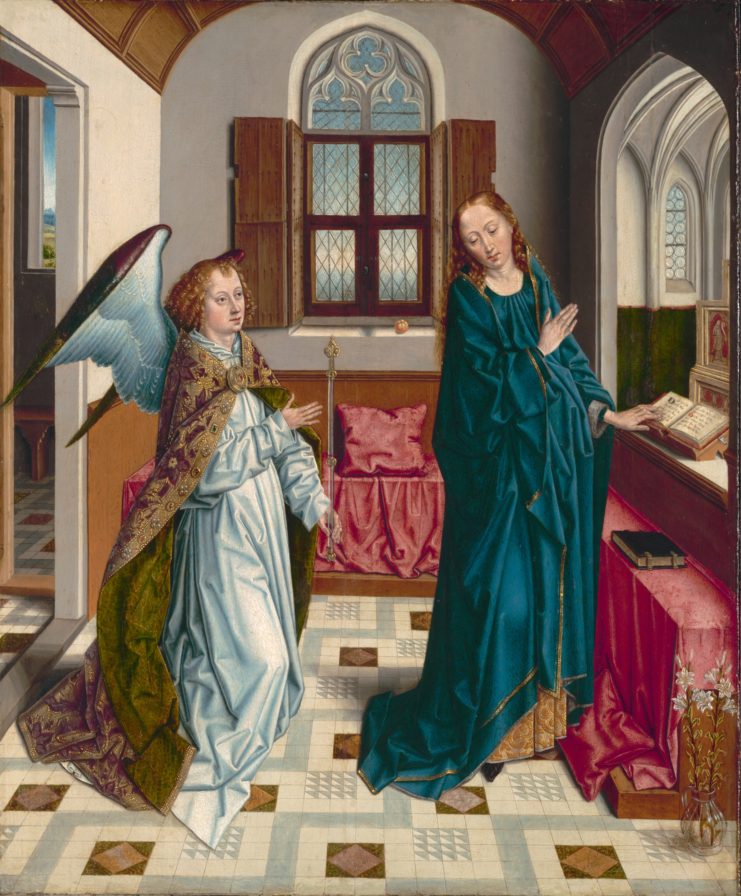</a>
<strong>The Annunciation</strong>
<small>Albert Bouts (Netherlandish, 1451/55–1549)</small>

<small>Photo licence reported: CC0 · Visual QA pending</small>

<small><a href="https://www.clevelandart.org/art/1942.635">Source photograph</a></small>
</td><td valign="top" width="20%"><strong>The Visitation</strong>
<a href="../../assets/staged/prayer-artwork-originals-20261101/champaigne-visitation.jpg">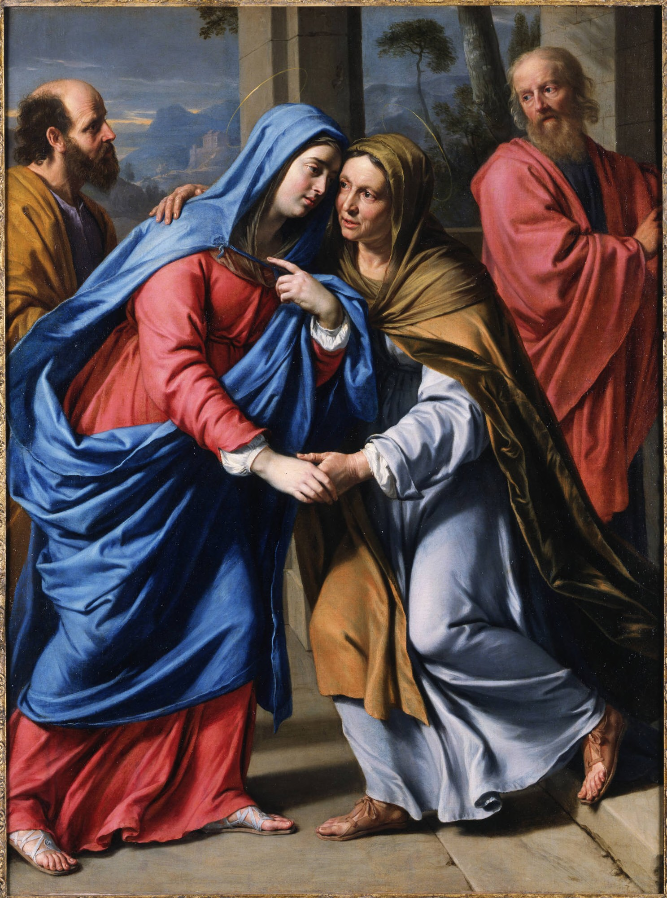</a>
<strong>The Visitation</strong>
<small>Philippe de Champaigne</small>

<small>Photo licence reported: Public domain · Visual QA pending</small>

<small><a href="https://commons.wikimedia.org/wiki/File:Philippe_de_Champaigne_-_The_Visitation_-_y1994-17_-_Princeton_University_Art_Museum.jpg">Source photograph</a></small>
</td><td valign="top" width="20%"><strong>The Nativity</strong>

<strong>NO ARCHIVED PHOTO</strong>

<strong>Adoration of the Magi</strong>
<small>Peter Paul Rubens</small>

<small>Original-file source required</small>
</td><td valign="top" width="20%"><strong>The Presentation</strong>
<a href="../../assets/staged/prayer-artwork-originals-20261101/rosary-presentation-champaigne-cc0.jpg">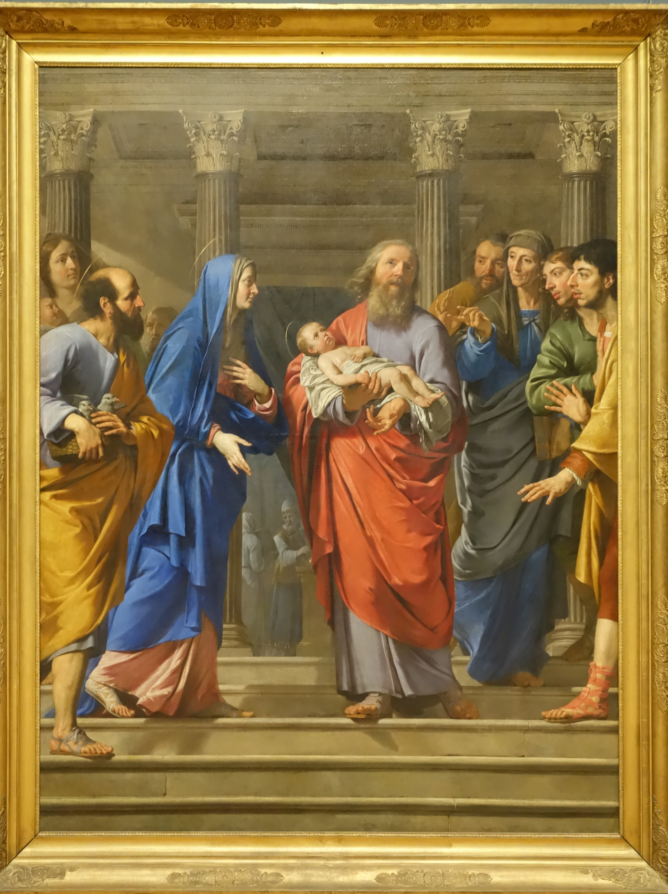</a>
<strong>Presentation of Jesus at the Temple</strong>
<small>Philippe de Champaigne</small>

<small>Photo licence reported: CC0 · Visual QA pending</small>

<small><a href="https://commons.wikimedia.org/wiki/File:The_Presentation_of_Jesus_Christ_at_the_Temple_by_Philippe_de_Champaigne_(Brussels).jpg">Source photograph</a></small>
</td><td valign="top" width="20%"><strong>Finding in the Temple</strong>
<a href="../../assets/staged/prayer-artwork-originals-20261101/rosary-finding-hondius-met.jpg">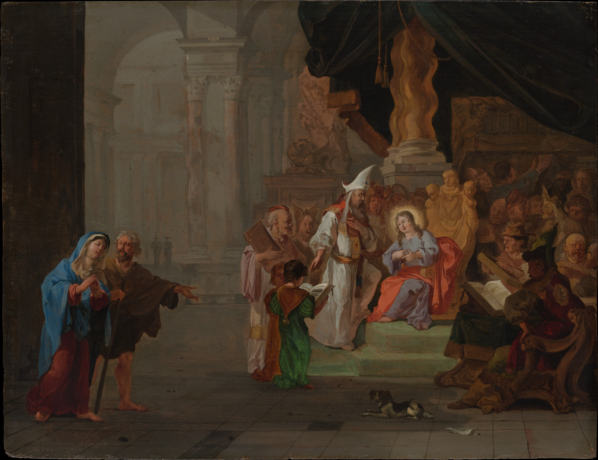</a>
<strong>Christ among the Doctors</strong>
<small>Abraham Hondius</small>

<small>Photo licence reported: Public domain · Visual QA pending</small>

<small><a href="https://www.metmuseum.org/art/collection/search/436672">Source photograph</a></small>
</td></tr></tbody></table>

## Sorrowful mysteries

<table><tbody><tr><td valign="top" width="20%"><strong>Agony in the Garden</strong>
<a href="../../assets/staged/prayer-artwork-originals-20261101/teniers-agony.jpg">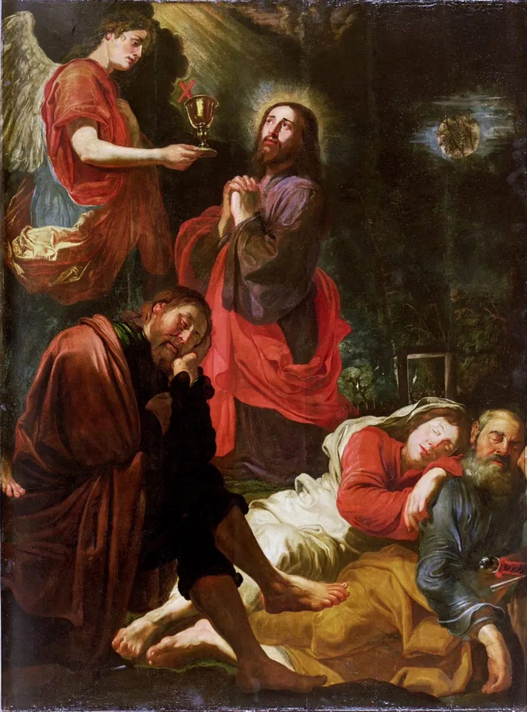</a>
<strong>Agony in the Garden — Antwerp Rosary cycle</strong>
<small>David Teniers the Elder</small>

<small>Photo licence reported: Public domain · Visual QA pending</small>

<small><a href="https://commons.wikimedia.org/wiki/File:David_Teniers_the_Elder_-_The_Agony_in_the_Garden.jpg">Source photograph</a></small>
</td><td valign="top" width="20%"><strong>Scourging at the Pillar</strong>

<strong>Christ at the Column</strong>
<small>Caravaggio</small>

<small>Photo licence reported: Public domain · Visual QA pending</small>

<small><a href="https://commons.wikimedia.org/wiki/File:Christ_at_the_Column-Caravaggio_(c._1607).jpg">Source photograph</a></small>
</td><td valign="top" width="20%"><strong>Crowning with Thorns</strong>
<a href="../../assets/staged/prayer-artwork-originals-20261101/baburen-thorns.jpg">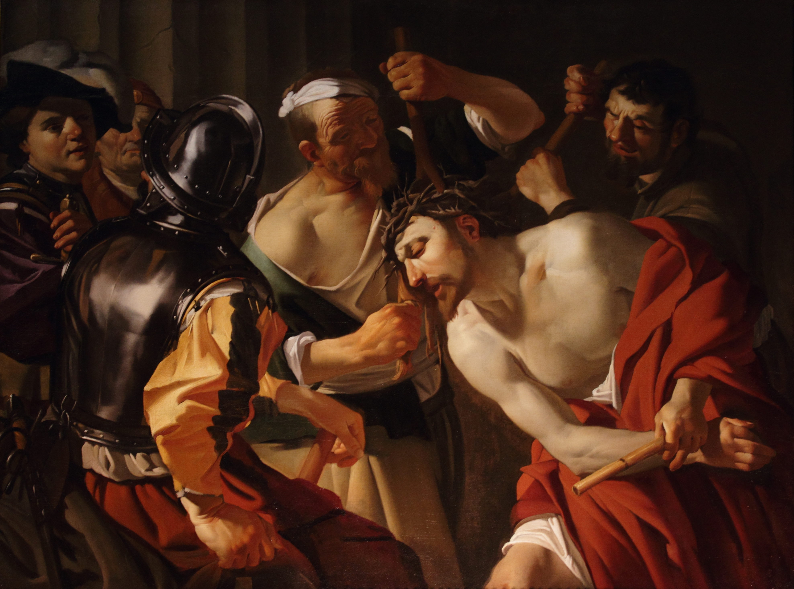</a>
<strong>Christ Crowned with Thorns</strong>
<small>Dirck van Baburen</small>

<small>Photo licence reported: Public domain · Visual QA pending</small>

<small><a href="https://commons.wikimedia.org/wiki/File:Le_Couronnement_d%27%C3%A9pines.JPG">Source photograph</a></small>
</td><td valign="top" width="20%"><strong>Carrying of the Cross</strong>
<a href="../../assets/staged/prayer-artwork-originals-20261101/domenichino-calvary.jpg">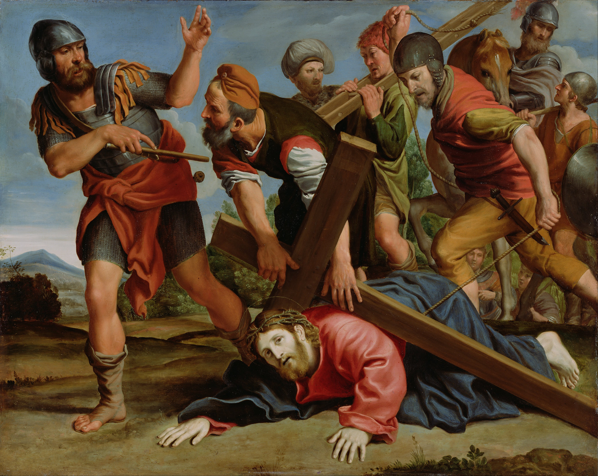</a>
<strong>The Way to Calvary</strong>
<small>Domenichino (Domenico Zampieri) (Italian, 1581 - 1641)</small>

<small>Photo licence reported: Public domain · Visual QA pending</small>

<small><a href="https://commons.wikimedia.org/wiki/File:Domenichino_(Domenico_Zampieri)_(Italian)_-_The_Way_to_Calvary_-_Google_Art_Project.jpg">Source photograph</a></small>
</td><td valign="top" width="20%"><strong>The Crucifixion</strong>
<a href="../../assets/staged/prayer-artwork-originals-20261101/rosary-crucifixion-jordaens-commons.jpg">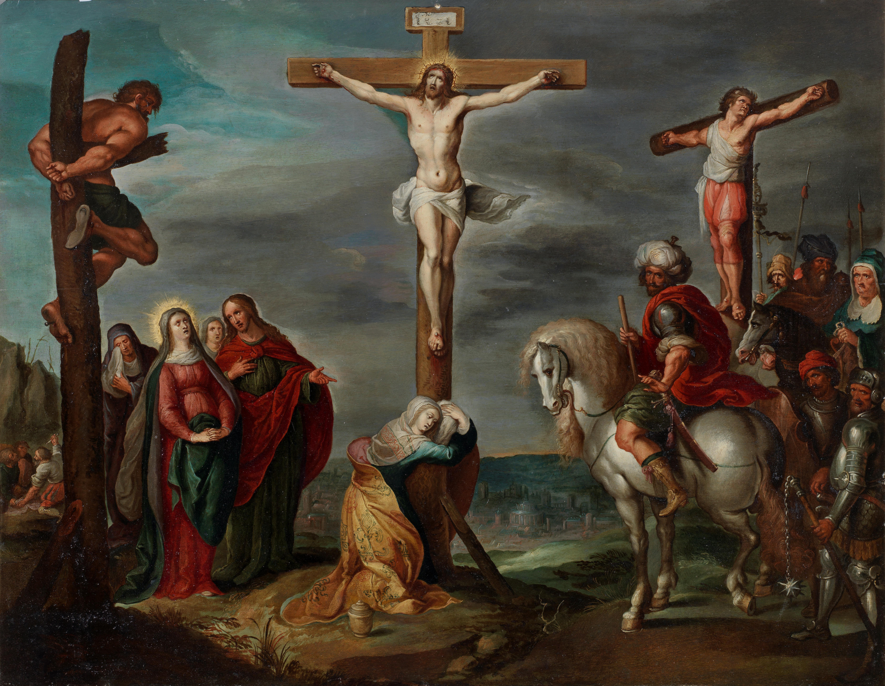</a>
<strong>Crucifixion</strong>
<small>Hans Jordaens III</small>

<small>Photo licence reported: Public domain · Visual QA pending</small>

<small><a href="https://commons.wikimedia.org/wiki/File:Hans_Jordaens_(III)_-_The_Crucifixion.jpg">Source photograph</a></small>
</td></tr></tbody></table>

## Glorious mysteries

<table><tbody><tr><td valign="top" width="20%"><strong>The Resurrection</strong>
<a href="../../assets/staged/prayer-artwork-originals-20261101/rubens-resurrection-central.jpg">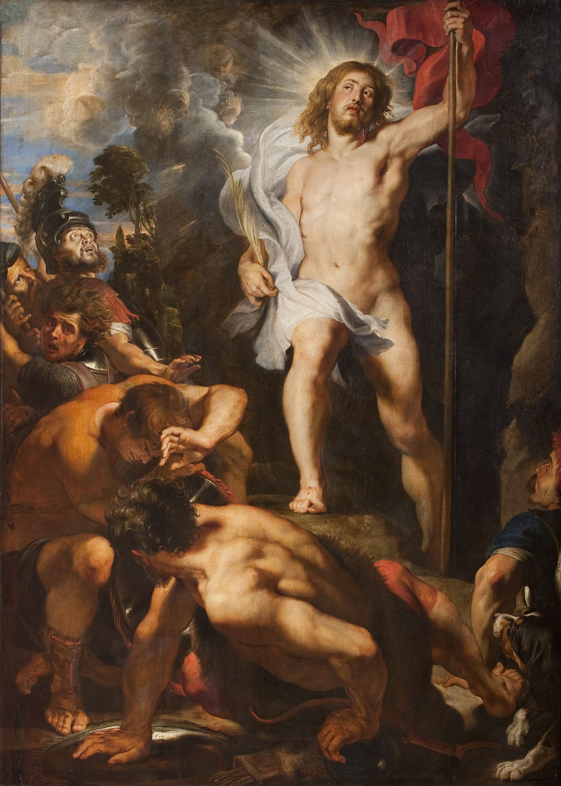</a>
<strong>Resurrection of Christ</strong>
<small>Peter Paul Rubens</small>

<small>Photo licence reported: Public domain · Visual QA pending</small>

<small><a href="https://commons.wikimedia.org/wiki/File:Peter_Paul_Rubens_-_Resurrection_of_Christ_triptych_(central_panel).jpg">Source photograph</a></small>
</td><td valign="top" width="20%"><strong>The Ascension</strong>

<strong>NO ARCHIVED PHOTO</strong>

<strong>The Ascension (after Leandro Bassano)</strong>
<small>David Teniers</small>

<small>Original-file source required</small>
</td><td valign="top" width="20%"><strong>Descent of the Holy Ghost</strong>

<strong>NO ARCHIVED PHOTO</strong>

<strong>Pentecost</strong>
<small>Mateo Cerezo</small>

<small>Original-file source required</small>
</td><td valign="top" width="20%"><strong>The Assumption</strong>
<a href="../../assets/staged/prayer-artwork-originals-20261101/lafosse-assumption.jpg">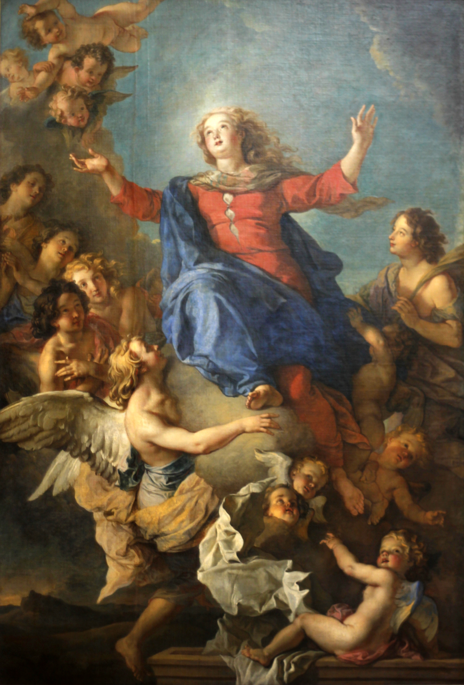</a>
<strong>Assumption of Mary &quot;</strong>
<small>Charles de La Fosse</small>

<small>Photo licence reported: Public domain · Visual QA pending</small>

<small><a href="https://commons.wikimedia.org/wiki/File:Charles_de_La_Fosse_-_L%27Assomption_vers_1680.jpg">Source photograph</a></small>
</td><td valign="top" width="20%"><strong>Coronation of Our Lady</strong>

<strong>EDITORIAL HOLD</strong>

<strong>No active primary</strong>
<small>Awaiting exact-scope resolution</small>

<small>Original-file source required</small>
</td></tr></tbody></table>

## Closing prayers — Salve Regina

The closing artwork remains on hold. An approved *Coronation* painting does not automatically become the closing *Salve Regina* image. Do not invent a replacement.

## Remaining acquisition and editorial blockers

- **Nativity (mystery 3):** Rubens *Adoration of the Magi* is explicitly accepted for this devotional association. The existing Prado-origin photograph is barred; acquire a verified non-Prado photograph of **the same original**, not another painting.
- **Ascension (mystery 12):** the selected David Teniers copy after Bassano is known, but the existing Commons source is 553 × 800 and cannot pass the current native-photo floor. Do not replace the work with another Ascension.
- **Pentecost (mystery 13):** the existing Mateo Cerezo file is 567 × 479. Seek a higher-resolution photo of the same original.
- **Coronation (mystery 15):** the primary remains held. Lochner and Carracci are both previously accepted **Coronation-specific alternatives**; no automatic primary selection.
- **Salve Regina closing:** separate held placement, not the sixteenth mystery.

## Release safeguards

The exact-original catalogue and staged photograph files must each retain original IDs, actual rights and provenance, dimensions, checksums, mobile/desktop crop QA, source photograph credit and modification disclosure. This contact sheet grants **no new user approval**, **no derivative artwork licence** and **no release manifest entry**.

Source ledgers: [267-position master](../../data/prayer/artwork-editorial-20261101/curatorial-master-267-20261101.v1.json), [124-group acquisition inventory](../../data/prayer/artwork-editorial-20261101/photo-release-acquisition-queue-267-20261101.v1.json), [B02 photo report](../../data/prayer/artwork-editorial-20261101/prayer-rosary-b02-acquisition-results.v1.json).
